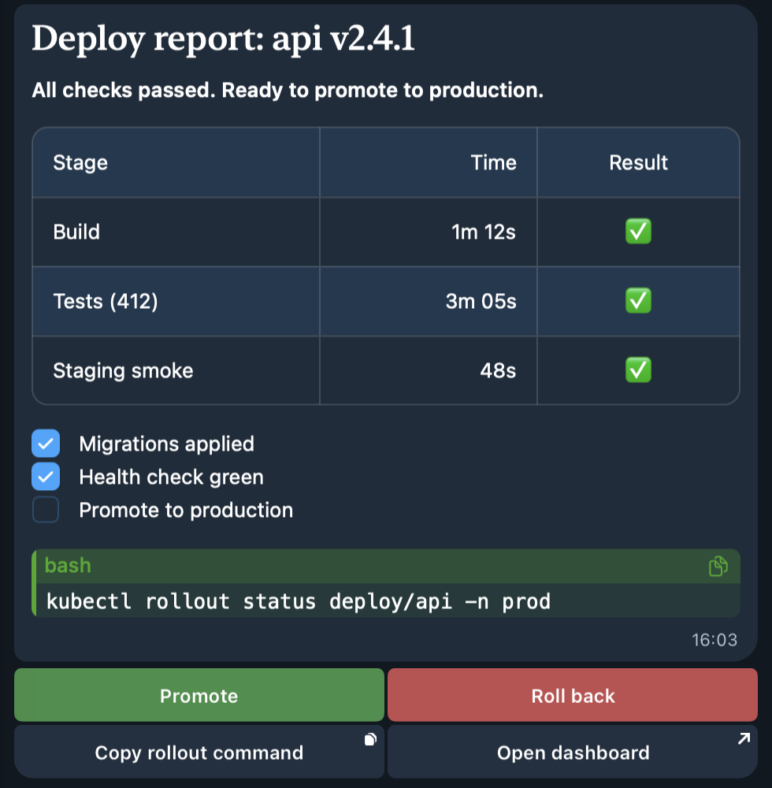
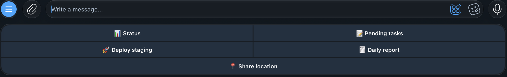

# telegram-plus: fork of the official Claude Code Telegram plugin

Fork of `telegram@claude-plugins-official` v0.0.7
([anthropics/claude-plugins-official](https://github.com/anthropics/claude-plugins-official),
`external_plugins/telegram`, upstream commit `1e96c6b`), Apache-2.0, see [LICENSE](./LICENSE) and [NOTICE](./NOTICE).
The first commit (tag `upstream-0.0.7`, branch `upstream`) is the upstream code, verbatim.

<p align="center">
  
</p>

One `reply` call: `format:"rich"` (heading, table, task list, code block with copy button) plus `buttons`
(callback with `style`, `copy_text`, `url`).

## Quick start

Needs `bun`, `python3`, `git`, and the official plugin already set up
(`/plugin install telegram@claude-plugins-official`, then the bot token and pairing, see the upstream README below).

1. Clone:

   ```bash
   git clone https://github.com/trongnguyenbinh/claude-telegram-plus.git
   cd claude-telegram-plus
   ```

2. Install (overlays the fork's `server.ts`, the `telegram-plus` skill and the progress hook onto the installed plugin, backs up the originals, prints the rollback command; safe to re-run):

   ```bash
   scripts/install.sh
   # optional: also turn on the typewriter for one project
   scripts/install.sh --project /abs/path/to/project [--state-dir ~/.claude/channels/telegram]
   ```

3. Restart each Telegram session so it loads the new server:

   ```bash
   claude --channels plugin:telegram@claude-plugins-official
   ```

Agents pick up a reply guideline (when to use rich messages, buttons, copy buttons, plain text)
from the server's MCP instructions and from the `telegram-plus` skill (`skills/telegram-plus/SKILL.md`,
loaded when Claude answers a Telegram message); nothing to configure. Details below.

It adds Telegram Bot API 10.x features. **All of them are opt-in.** With none of the new
arguments, every upstream tool sends the exact request it sent before:
`scripts/test-upstream-compat.sh` runs those tests against the pristine upstream server.

| Tool / option | Bot API | Where it works |
|---|---|---|
| `reply` / `edit_message` `format: "rich"`: Rich Messages (plain Markdown: headings, lists, task lists, tables, code, quotes, `<details>`, no escaping, 32768 chars) | `sendRichMessage`, `editMessageText.rich_message` (10.1) | all chats |
| `reply` / `edit_message` `buttons`: inline keyboard with callback, url, copy-text buttons, `style` primary/success/danger. A press arrives in the session as `(button) <data>` with `callback_query_id`; the presser gets a `✓ <label>` toast and the keyboard collapses to `✅ <label>` (see [Button presses](#button-presses)) | `reply_markup`, `InlineKeyboardButton.style` (9.4), `copy_text`, `answerCallbackQuery`, `editMessageReplyMarkup` | all chats; presses accepted from the same people the inbound gate allows |
| `reply` `keyboard` (+ `keyboard_options`), `remove_keyboard`, `force_reply`: reply keyboard under the input field, with text, contact, location, poll, users, chat and Web App buttons. A plain press arrives as a normal text message; request buttons arrive as `(contact) ...`, `(location) lat,lon`, `(poll) ...`, `(users_shared ...)`, `(chat_shared ...)`, `(web_app_data ...)` | `ReplyKeyboardMarkup`, `ReplyKeyboardRemove`, `ForceReply` | text buttons everywhere; request and Web App buttons in private chats only; one reply_markup per message, so never together with `buttons` |
| `reply` `ephemeral_for` (+ `callback_query_id`, `replace_callback_message`, `reply_to_ephemeral`): a message only one group member sees | `ephemeral_message_parameters` (10.2/10.3) | groups/supergroups; within 15s of the user's action, or any time if the bot is admin; delivery not guaranteed |
| `edit_message` / `delete_message` with `ephemeral_for` | `editEphemeralMessageText`, `deleteEphemeralMessage` | groups |
| incoming ephemeral messages and commands: delivered without needing a mention, with `ephemeral_message_id` | `Message.ephemeral_message_id` (10.2) | allowlisted groups |
| `stream_draft`: live typing preview, `''` = "Thinking…", optional Stop button (press arrives as `(stopped generation)`) | `sendMessageDraft`, `sendRichMessageDraft`, `stopped_message_generation` (9.5/10.1/10.3) | private chats; preview lasts about 30s, finish with `reply` |
| `delete_message` | `deleteMessage` | all chats |
| `reply` `effect_id`, `silent`; `react` `big` | `message_effect_id`, `disable_notification`, `is_big` | effects: private chats only |
| `reply` `typewriter` (default from env `TELEGRAM_PLUS_TYPEWRITER=1`, off when unset): replays the first ~600 chars word by word in a draft (4-8 frames, ≤1.5s), then sends the real message unchanged | `sendMessageDraft` / `sendRichMessageDraft` | private chats, no files, not ephemeral; draft errors are ignored |
| Welcome new group members: the server itself greets people who join an allowlisted group, using `<STATE_DIR>/welcome.json` (see below). Claude is not involved | `new_chat_members` service message, `sendMessage` + `text_mention` entities | allowlisted groups; works in privacy mode, no admin needed |
| `TELEGRAM_API_ROOT` env | local Bot API server or the offline test mock | |
| `hooks/telegram-progress.py` (Claude Code hook, registered by the plugin's `hooks/hooks.json`): live draft of what the agent is doing during a Telegram turn | `sendMessageDraft` | private chats; see [hooks/README.md](./hooks/README.md) |

## Reply keyboard



```json
{ "chat_id": "123", "text": "Menu", "keyboard": [["Status", "Logs"], [{ "text": "Share location", "request_location": true }]],
  "keyboard_options": { "resize": true, "one_time": true, "placeholder": "Pick one" } }
```

- Buttons are strings or `{text, style?, request_contact?, request_location?, request_poll?, request_users?, request_chat?, web_app?}`.
  `request_users` / `request_chat` take the Bot API object and need a `request_id`; `web_app` takes an https URL.
- `keyboard_options`: `resize`, `one_time`, `persistent`, `placeholder` (1-64 chars), `selective`.
  `remove_keyboard: true` removes it; `force_reply: true` opens the reply box (placeholder and selective apply).
- Telegram allows one `reply_markup` per message: combining `buttons` (inline) with `keyboard`, `remove_keyboard`
  or `force_reply` is an error, and nothing is sent.
- Request and Web App buttons work in private chats only (Bot API); the server refuses them for groups.
  In groups use `selective` with `reply_to`. A plain press is an ordinary group message, so it passes the
  usual gate: with `requireMention` it reaches Claude only if it is a reply to the bot or mentions it.
- Inbound contact, location (and venue), poll, users_shared, chat_shared and web_app_data messages are
  forwarded as one line of text, only from senders the gate allows.
- Inline `buttons` stay the default for a choice inside one message. Use a reply keyboard for a fixed menu.

## Welcome new members

Create `<STATE_DIR>/welcome.json` (same directory as `access.json`, default `~/.claude/channels/telegram`):

```json
{ "-1001234567890": "Chào {name}, ..." }
```

- The key is the group's chat_id. The group must also be in `access.json` `groups`.
  No file, no key, or an empty text means no welcome.
- `{name}` becomes `@username`, or the first name for people without one. Each name
  is a clickable mention, sent as a `text_mention` entity: no parse mode, so names never
  need escaping. Several joiners become `A, B và C`. With more than 10 people, the
  first 10 are listed, then `và N người khác`.
- The file is re-read on every join, like `access.json`, so edits apply without a
  restart. It is deliberately separate from `access.json`, which is only edited from the terminal.
- Bots that join are ignored. Joins within 3s are merged into one message, and each group
  gets at most one welcome every 30s. Later joiners are queued for the next message,
  not dropped.
- Telegram sends the join service message to bots in privacy mode too, no admin rights needed
  (core.telegram.org/bots/features#privacy-mode). The `chat_member` update is not used:
  it needs admin rights and an explicit `allowed_updates`.

## Button presses

What the presser sees, so they know the bot got it:

1. The press is handed to Claude first. Only then the toast `✓ <button label>` shows. If it could not reach Claude: `⚠️ Not delivered to Claude, try again later` and the keyboard stays.
2. The keyboard collapses to one button `✅ <label>`, so the choice stays visible in the chat and can't be sent twice. Pressing it again shows `Already chosen`. The message text is not touched, so rich and MarkdownV2 messages keep their formatting.
3. A second press on the same message within 10 minutes (a fast double tap, before the collapse lands) is not delivered again: `Already received`.
4. A typing indicator starts right away and stays up until the reply (see below).

Pass `keep_buttons: true` on `reply` / `edit_message` for a menu or pager meant to be pressed again: toast only, no collapse, every press delivered. Toasts are English, or Vietnamese when the presser's Telegram app language is `vi`. Permission-relay buttons (`perm:`) keep the upstream behaviour.

## Liveness: server.log, heartbeat, one poller per bot

- `STATE_DIR/server.log`: start (version, ppid, MCP client, mode), `polling as @bot`, 409s, stalls, and why the server shut down (`stdin end`, `SIGTERM`, ...). No message content; token-shaped strings are masked. Rotated to `server.log.1` past 1MB.
- `STATE_DIR/bot.heartbeat`: `{pid, state, at}`, rewritten after every completed `getUpdates` (at most once per second). `state` is `conflict` while a 409 lasts.
- In-process stall watchdog: if no `getUpdates` completed for 120 s (checked every 30 s, each `getUpdates` capped at 60 s), the poll loop is restarted. A check that runs far too late (host asleep) only rebases the clock. If the old loop can't stop within 15 s (a handler stuck), the server exits so it shows up as dead and gets reconnected.
- 409 Conflict never gives up: retries back off 1 s, 2 s, 4 s ... up to 10 min, each one logged.
- `bot.pid` holder: a new server replaces it only if it is orphaned (its Claude Code is gone) or is its own predecessor (same client, e.g. `/mcp` Reconnect). If the holder belongs to another live session, e.g. a `claude -p` run from a Bash tool inside a channel session that inherited `TELEGRAM_STATE_DIR`, the new server runs **send-only**: tools work, no polling, and it leaves `bot.pid` alone. Before, such a child killed the session's poller and then deleted `bot.pid` on exit.

## Install, restore, update

`scripts/install.sh` runs the checks and `install-overlay.sh` for you. See [RESTORE.md](./RESTORE.md) for restore after a plugin update and rollback.
By hand: `scripts/install-overlay.sh` (dry run), then `--apply`. It copies `server.ts`, `skills/telegram-plus/` and `hooks/{hooks.json,telegram-progress.py}`
into the plugin dir (the upstream `access` and `configure` skills are left alone); backups and `--rollback` cover all of them.
A new `server.ts` loads on `/mcp` Reconnect; the skill and hooks load only when the session restarts.

## Channel watchdog (herdr)

Sometimes the channel process dies while the claude session lives on: `bot.pid` is gone or dead and `/mcp` shows `✘ plugin:telegram:telegram`. `scripts/tg-watchdog.py` (python3 stdlib) watches sessions running in [herdr](https://herdr.dev) panes and does the manual fix for you: waits until the agent is idle, leaves a typed draft alone, opens `/mcp`, walks to the telegram row by reading the screen, picks Reconnect, checks the new `bot.pid`, and reports via the Bot API (at most one attempt per agent per 10 min).

It also catches a channel that is alive but deaf: `bot.pid` is alive but `bot.heartbeat` is older than 3 min (`heartbeat_stale_s`), so no `getUpdates` completed. That is reconnected the same way, and success means a new pid whose own heartbeat came in. A heartbeat saying `conflict` (409, another poller has the token) is reported, not reconnected.

```bash
python3 scripts/tg-watchdog.py --config watchdog.json --once --dry-run   # detect + log only
python3 scripts/tg-watchdog.py --config watchdog.json                    # loop, every 60 s
```

The config format is in the script's docstring. Servers older than v0.0.7-plus.5 write no heartbeat; for them only a dead `bot.pid` is detected.

### Push to the repo, every bot follows

The channel has to stay `telegram@claude-plugins-official`: during the channels preview `--channels` only registers allowlisted plugins, and a plugin from your own marketplace needs `--dangerously-load-development-channels`, which shows a confirmation dialog at every start. So updates keep using the overlay:

- `scripts/tgp-update.sh`: `git pull --ff-only`, then `install-overlay.sh --apply` when the installed server.ts is upstream or an older fork build, or when only the skill/hook files changed. Exit 3 (nothing written) when it is neither: the official plugin updated itself or was edited; merge upstream first (RESTORE.md).
- In the watchdog config: `"update_every_s": 3600` runs it from the loop; `"reload_on_update": true` reconnects a live server whose `start v…` in `server.log` differs from the overlay on disk, once its agent is idle with an empty prompt (busy agents are retried next round; 3 failed tries per version, then it only reports). An agent with `"manual": true` (e.g. the main session) is never typed into: dead, deaf or outdated channels are only reported. A plugin dir without `.telegram-plus` is reported, never overwritten.

## Tests and audit (offline, no real token)

```bash
bun install
bun test                          # mock Bot API + real server.ts over MCP stdio, install.sh in a sandbox
python3 hooks/test_telegram_progress.py   # progress hook, mock Bot API
python3 scripts/test_tg_watchdog.py       # watchdog screen parsing + heartbeat health
scripts/test-upstream-compat.sh   # default behaviour == upstream
gitleaks git --redact . && trufflehog git file://. --no-update --fail
```

---

*Upstream README follows.*

# Telegram

Connect a Telegram bot to your Claude Code with an MCP server.

The MCP server logs into Telegram as a bot and provides tools to Claude to reply, react, or edit messages. When you message the bot, the server forwards the message to your Claude Code session.

## Prerequisites

- [Bun](https://bun.sh) — the MCP server runs on Bun. Install with `curl -fsSL https://bun.sh/install | bash`.

## Quick Setup
> Default pairing flow for a single-user DM bot. See [ACCESS.md](./ACCESS.md) for groups and multi-user setups.

**1. Create a bot with BotFather.**

Open a chat with [@BotFather](https://t.me/BotFather) on Telegram and send `/newbot`. BotFather asks for two things:

- **Name** — the display name shown in chat headers (anything, can contain spaces)
- **Username** — a unique handle ending in `bot` (e.g. `my_assistant_bot`). This becomes your bot's link: `t.me/my_assistant_bot`.

BotFather replies with a token that looks like `123456789:AAHfiqksKZ8...` — that's the whole token, copy it including the leading number and colon.

**2. Install the plugin.**

These are Claude Code commands — run `claude` to start a session first.

Install the plugin:
```
/plugin install telegram@claude-plugins-official
```

**3. Give the server the token.**

```
/telegram:configure 123456789:AAHfiqksKZ8...
```

Writes `TELEGRAM_BOT_TOKEN=...` to `~/.claude/channels/telegram/.env`. You can also write that file by hand, or set the variable in your shell environment — shell takes precedence.

> To run multiple bots on one machine (different tokens, separate allowlists), point `TELEGRAM_STATE_DIR` at a different directory per instance.

**4. Relaunch with the channel flag.**

The server won't connect without this — exit your session and start a new one:

```sh
claude --channels plugin:telegram@claude-plugins-official
```

**5. Pair.**

With Claude Code running from the previous step, DM your bot on Telegram — it replies with a 6-character pairing code. If the bot doesn't respond, make sure your session is running with `--channels`. In your Claude Code session:

```
/telegram:access pair <code>
```

Your next DM reaches the assistant.

> Unlike Discord, there's no server invite step — Telegram bots accept DMs immediately. Pairing handles the user-ID lookup so you never touch numeric IDs.

**6. Lock it down.**

Pairing is for capturing IDs. Once you're in, switch to `allowlist` so strangers don't get pairing-code replies. Ask Claude to do it, or `/telegram:access policy allowlist` directly.

## Access control

See **[ACCESS.md](./ACCESS.md)** for DM policies, groups, mention detection, delivery config, skill commands, and the `access.json` schema.

Quick reference: IDs are **numeric user IDs** (get yours from [@userinfobot](https://t.me/userinfobot)). Default policy is `pairing`. `ackReaction` only accepts Telegram's fixed emoji whitelist.

## Tools exposed to the assistant

| Tool | Purpose |
| --- | --- |
| `reply` | Send to a chat. Takes `chat_id` + `text`, optionally `reply_to` (message ID) for native threading and `files` (absolute paths) for attachments. Images (`.jpg`/`.png`/`.gif`/`.webp`) send as photos with inline preview; other types send as documents. Max 50MB each. Auto-chunks text; files send as separate messages after the text. Returns the sent message ID(s). |
| `react` | Add an emoji reaction to a message by ID. **Only Telegram's fixed whitelist** is accepted (👍 👎 ❤ 🔥 👀 etc). |
| `edit_message` | Edit a message the bot previously sent. Useful for "working…" → result progress updates. Only works on the bot's own messages. |

Inbound messages trigger a typing indicator automatically — Telegram shows
"botname is typing…" while the assistant works on a response.

telegram-plus keeps it up: Telegram drops a chat action after ~5 s, so it is resent every 4 s until the bot
sends a `reply` to that chat, 10 min pass, or the server stops (`edit_message`, `react`, `stream_draft` don't stop it;
a new message resets the 10 min; a 429 waits `retry_after`). Knobs: `TELEGRAM_PLUS_TYPING_EVERY_MS`, `TELEGRAM_PLUS_TYPING_MAX_MS`.

## Photos

Inbound photos are downloaded to `~/.claude/channels/telegram/inbox/` and the
local path is included in the `<channel>` notification so the assistant can
`Read` it. Telegram compresses photos — if you need the original file, send it
as a document instead (long-press → Send as File).

## No history or search

Telegram's Bot API exposes **neither** message history nor search. The bot
only sees messages as they arrive — no `fetch_messages` tool exists. If the
assistant needs earlier context, it will ask you to paste or summarize.

This also means there's no `download_attachment` tool for historical messages
— photos are downloaded eagerly on arrival since there's no way to fetch them
later.
